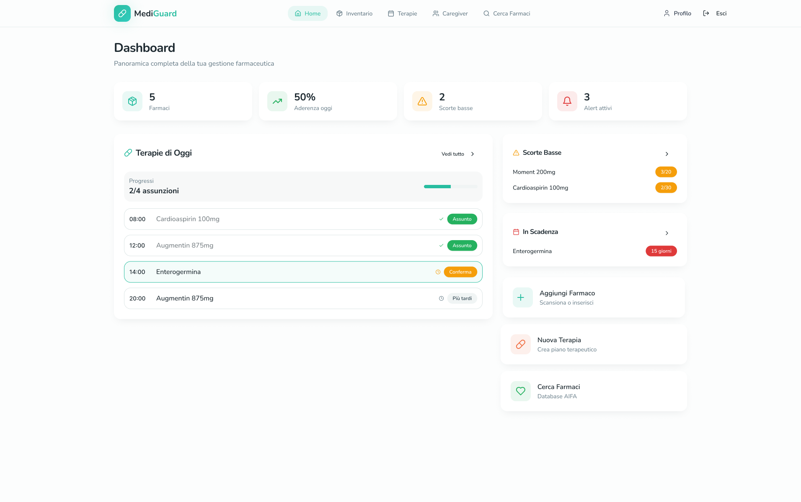
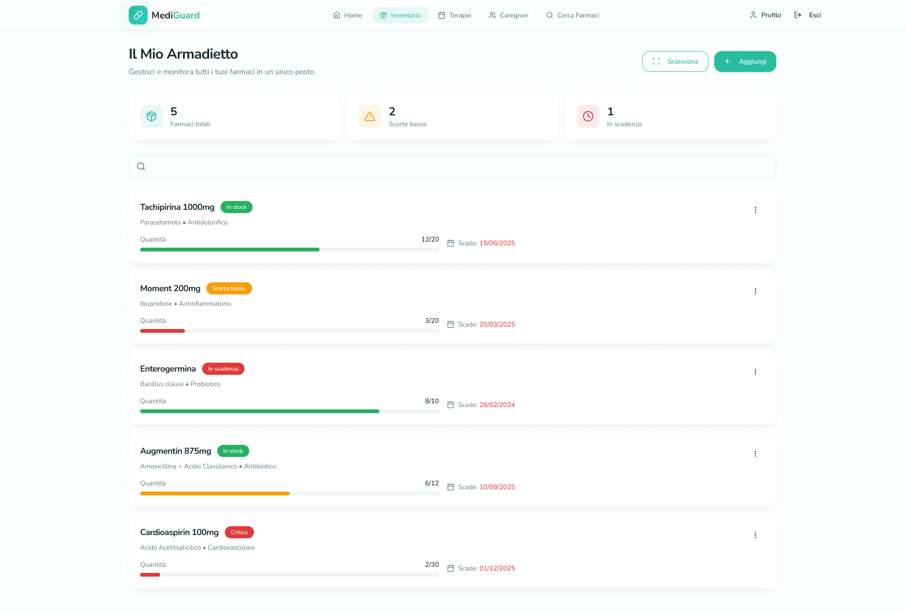
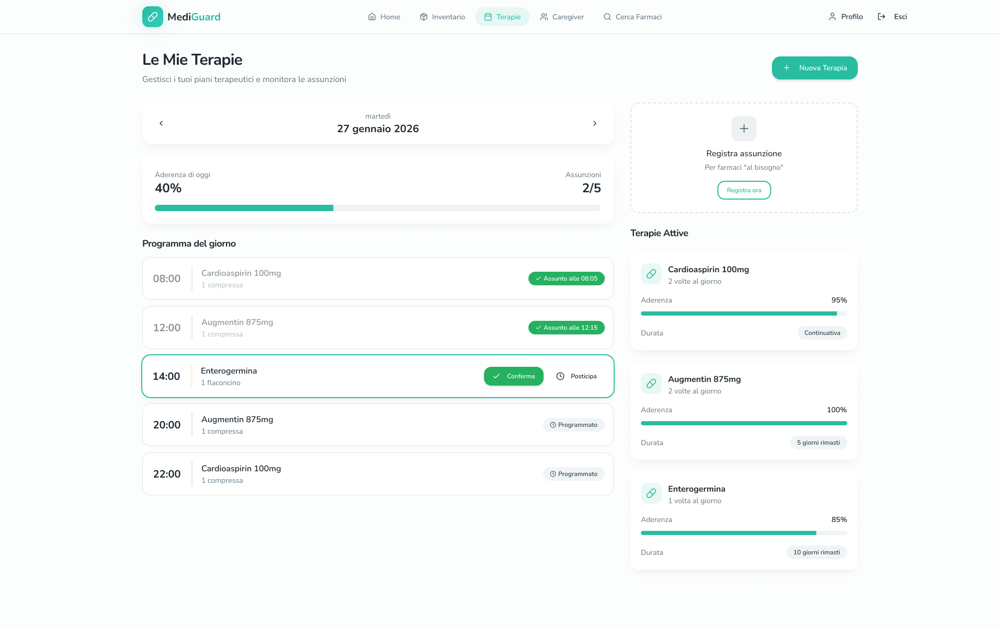
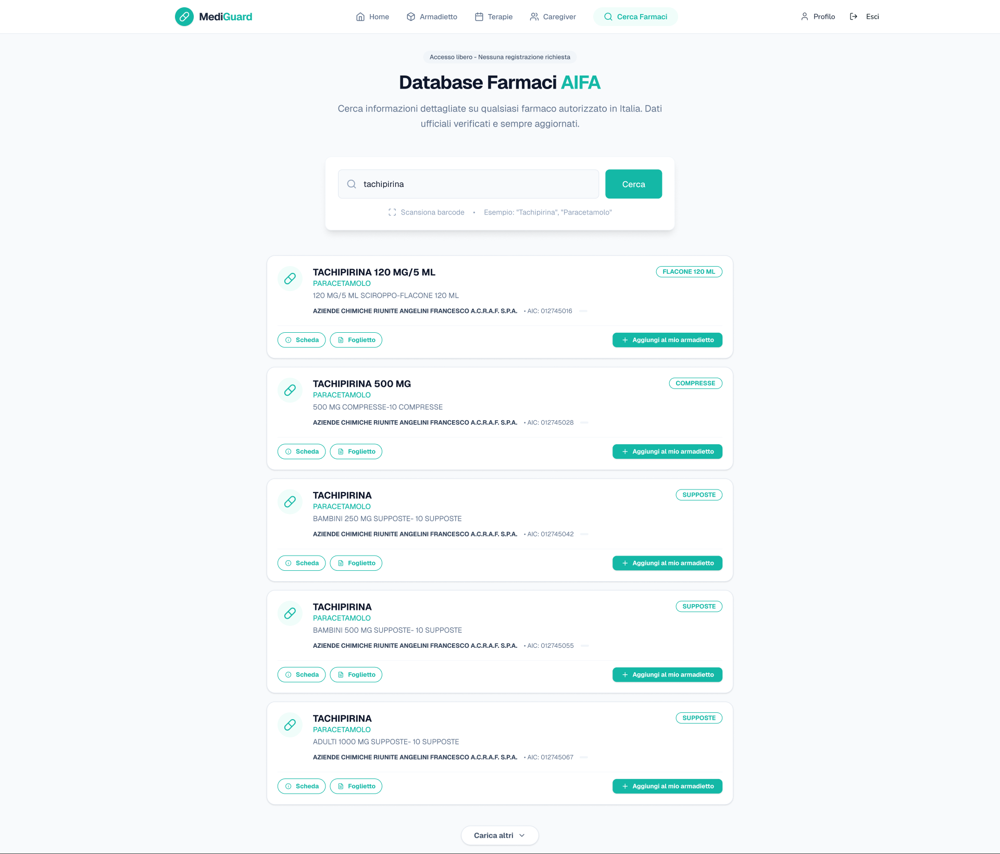
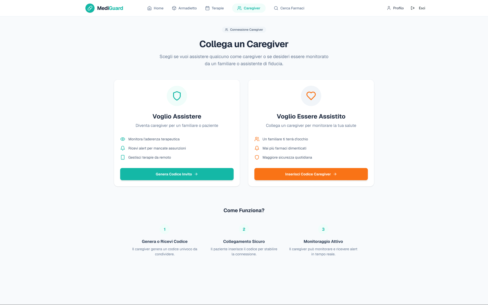
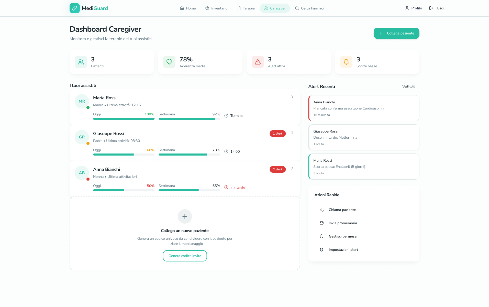

# MediGuard – Full-Stack Pharmaceutical Inventory Management Platform

MediGuard is a full-stack web application designed to help users manage their medication inventory, organize therapies, monitor medication availability and expiration dates, and coordinate care activities with caregivers.

The platform combines a web application, a PostgreSQL database, and IoT integration to provide a centralized environment for medication management.

## Features

### Medication Management
- Manage personal medication inventories.
- Track medication quantities and expiration dates.
- Add, update, and remove medications.
- Search for medication information.

### Therapy Management
- Create and manage medication therapies.
- Organize medication schedules and dosage information.
- Track medication intake.
- Receive notifications related to scheduled medication activities.

### User and Caregiver Management
- User registration and authentication.
- Manage caregiver–assisted person relationships.
- Link accounts through dedicated connection codes.
- Provide caregivers with access to relevant assisted-person information.

### Notifications
- Web Push notification support.
- Medication-related reminders and notifications.
- Backend endpoints for managing push subscriptions.

### IoT Integration
- Integration with ESP32-based devices.
- Communication between the web application and connected hardware.
- Support for synchronization and device confirmation workflows.

## Application Screenshots

The following screenshots show the actual application interface. The displayed information is fictional demonstration data.

### User Dashboard



### Medication Inventory



### Therapy Management



### Medication Search



### Caregiver Management



### Caregiver Dashboard



## Architecture

MediGuard is built around a full-stack web architecture.

- **Frontend:** Next.js and React provide the user interface and application navigation.
- **Backend:** Next.js API Routes implement the application's server-side functionality and REST-style endpoints.
- **Database:** PostgreSQL stores application data.
- **ORM:** Prisma manages database access and schema definition.
- **Containerization:** Docker and Docker Compose support the application environment and database setup.
- **IoT:** ESP32-based devices communicate with the application through dedicated API endpoints.

The application includes separate modules for authentication, medication management, therapies, caregiver relationships, notifications, and IoT communication.

## Technology Stack

| Category | Technologies |
|---|---|
| Frontend | Next.js, React, JavaScript |
| Styling | CSS Modules, CSS |
| Backend | Next.js API Routes |
| Database | PostgreSQL |
| ORM | Prisma |
| Authentication | JWT, bcryptjs |
| Notifications | Web Push |
| Containerization | Docker, Docker Compose |
| IoT | ESP32, embedded integration |

## Project Structure

```text
mediguard/
├── prisma/
│   └── schema.prisma
├── public/
├── src/
│   ├── app/
│   │   ├── api/
│   │   └── Pages/
│   ├── components/
│   └── ...
├── .dockerignore
├── .env.example
├── .gitignore
├── Dockerfile
├── docker-compose.yml
├── package.json
└── README.md
```

## Getting Started

### Prerequisites

Make sure the following tools are available:

- Git
- Node.js and npm
- Docker
- Docker Compose

### 1. Clone the repository

```bash
git clone https://github.com/SebaGra-coder/MediGuard-Full-Stack-Pharmaceutical-Inventory-Management-Platform.git
cd MediGuard-Full-Stack-Pharmaceutical-Inventory-Management-Platform
```

### 2. Configure environment variables

Create your local environment file using the example:

```bash
cp .env.example .env
```

On Windows PowerShell:

```powershell
Copy-Item .env.example .env
```

Update the environment variables with your local configuration.

In particular, configure:

- PostgreSQL connection settings.
- A secure JWT secret.
- Web Push VAPID keys and subject.

Never commit your actual `.env` file or private keys.

### 3. Start the Docker environment

```bash
docker compose up -d --build
```

### 4. Install dependencies

```bash
npm ci
```

### 5. Generate the Prisma Client

```bash
npx prisma generate
```

Apply the database migrations using the migration workflow included in the repository.

### 6. Start the application

```bash
npm run dev
```

Open the local address displayed by Next.js in your terminal.

## Available Scripts

| Command | Description |
|---|---|
| `npm run dev` | Starts the development server |
| `npm run build` | Creates a production build |
| `npm run start` | Starts the production server |
| `npm run lint` | Runs ESLint |

## My Contribution

MediGuard was developed as a team project. My contribution covered a substantial part of the application's development and technical coordination.

My responsibilities included:

- Technical supervision and coordination of development activities.
- Frontend implementation and interface integration.
- Backend development through Next.js API Routes.
- Integration of API modules developed by other team members.
- Database and application component integration.
- Docker and deployment environment configuration.
- Coordination between the web application and IoT-related components.

This experience involved working across the full-stack architecture, integrating independently developed components, and maintaining consistency between frontend, backend, database, and external hardware.

## Project Context

MediGuard was developed as an academic team project between November 2025 and February 2026.

The project explored the integration of web technologies, database management, notifications, and IoT devices in the context of medication and caregiver management.

The application is currently maintained as a portfolio project.

## Repository

[GitHub – MediGuard](https://github.com/SebaGra-coder/MediGuard-Full-Stack-Pharmaceutical-Inventory-Management-Platform)